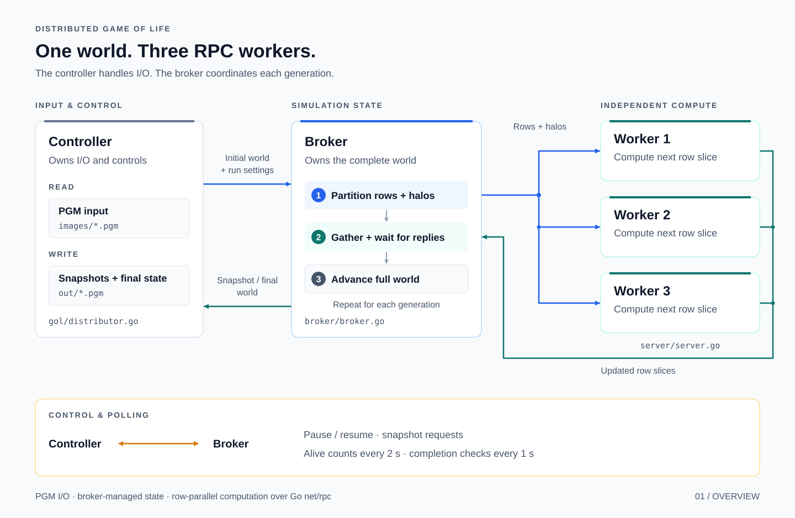
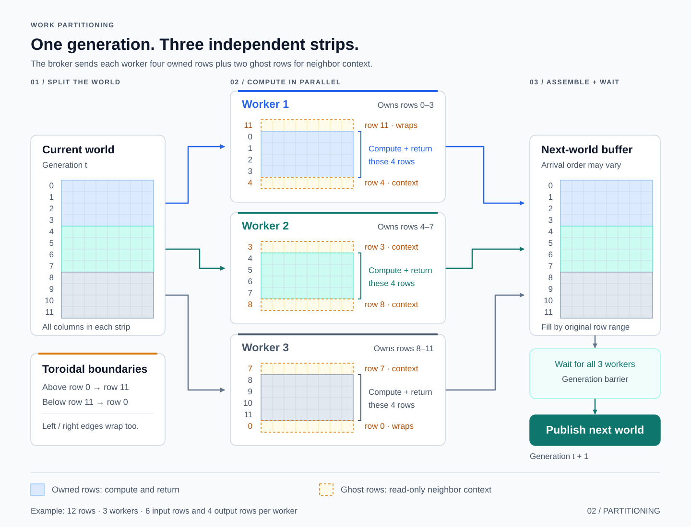

# Distributed Game of Life Implementation

**Go · RPC · Goroutines · Grid partitioning · AWS EC2**

## Overview

A distributed implementation of Conway's Game of Life, a grid simulation in which each cell evolves from its eight neighbors. A controller loads the starting board, a broker coordinates each generation, and networked workers compute separate row slices.

The accompanying [project report](#project-report-and-design-notes) follows the work from parallel execution on one machine to a distributed design deployed on AWS EC2.

[Architecture](#system-architecture) · [Project report](#project-report-and-design-notes) · [Run locally](#run-locally) · [Code guide](#explore-the-implementation)

## System architecture



### Design choices

- **Separate responsibilities:** the controller handles input, output, and user commands; the broker owns the world state; workers calculate the next state of assigned rows.
- **Concurrent RPC work:** the broker keeps connections to its workers and launches one goroutine per worker for each generation.
- **Explicit synchronization:** results return to their original row positions, and a `sync.WaitGroup` barrier gates publication of the next world.
- **Interactive control:** pause/resume requests, PGM snapshots, and live-cell counts polled every two seconds.

## One generation, end to end

1. **Partition.** Split the world into horizontal strips. Include one neighboring row above and below each strip so workers can evaluate cells at partition boundaries.
2. **Compute.** Workers apply Conway's rules to their assigned rows in parallel. The world wraps at its outer edges.
3. **Assemble and publish.** Copy each returned strip into its original row range. Once all worker requests finish, publish the assembled world and advance the turn.



## Project report and design notes

The original report brings together the implementation, parallel-processing experiments, CPU profiling, AWS instance selection, and worker-count comparisons.

<summary>Read the original project report</summary>


<summary>Explore the original architecture and extension sketches</summary>

These drawings document the project's design progression and extension ideas. The broker diagram also shows the controller's I/O channels and SDL event flow in more detail.

| Design topic | Original drawings |
|---|---|
| Controller and remote engine | [Initial architecture](content/cw_diagrams-Distributed_1.png) |
| Monitoring and state | [Status polling](content/cw_diagrams-Distributed_2.png) · [State handling](content/cw_diagrams-Distributed_3.png) |
| Interactive controls | [Keyboard control flow](content/cw_diagrams-Distributed_4.png) |
| Distributed coordination | [Multi-worker layout](content/cw_diagrams-Distributed_5.png) · [Controller I/O and broker–worker design](content/cw_diagrams-Distributed_6.png) |
| Extension sketches | [Direct halo exchange](content/cw_diagrams-Extensions_1.png) · [Parallelism within each node](content/cw_diagrams-Extensions_2.png) |

## Run locally

<details>
<summary>Set up one controller, one broker, and three local workers</summary>

### Prerequisites

Use a Go toolchain compatible with the [module's Go 1.17 target](gol-skeleton-master-distributed/go.mod). The controller also uses a C compiler with cgo support, SDL2 development libraries, and `pkg-config` on macOS/Linux. Both windowed and headless controller modes use this build setup. See the [SDL binding setup guide](https://github.com/veandco/go-sdl2/tree/v0.4.38#requirements).

Clone the repository and enter the Go module:

```bash
git clone https://github.com/Philjae-Shin/Distribute-gol.git
cd Distribute-gol/gol-skeleton-master-distributed
```

### Configure the endpoints

For a local run, set `workerAddrs` in [`broker/broker.go`](gol-skeleton-master-distributed/broker/broker.go) to:

```go
workerAddrs := []string{
    "127.0.0.1:8031",
    "127.0.0.1:8032",
    "127.0.0.1:8033",
}
```

Set the broker connection in [`gol/distributor.go`](gol-skeleton-master-distributed/gol/distributor.go) to:

```go
client, err := rpc.Dial("tcp", "127.0.0.1:8030")
```

The broker's address list determines the number of workers. For a deployment across machines, use the workers' reachable addresses and the broker's reachable address in these same locations.

### Start the processes

Run each command in a **separate terminal**, from `gol-skeleton-master-distributed/`. Start the workers first, then the broker, then the controller.

| Order | Process | Command |
|---|---|---|
| 1 | Worker 1 | `go run ./server -port 8031` |
| 2 | Worker 2 | `go run ./server -port 8032` |
| 3 | Worker 3 | `go run ./server -port 8033` |
| 4 | Broker | `go run ./broker` |
| 5 | Controller | `go run . -w 512 -h 512 -turns 100 -headless` |

This example reads `images/512x512.pgm` and, after 100 generations, writes `out/512x512x100.pgm`. Snapshots follow the pattern `out/<width>x<height>x<completed-turn>.pgm`.

### Interactive controls

Omit `-headless` to use the SDL window's keyboard controls:

| Key | Action |
|---|---|
| `s` | Save a PGM snapshot of the current world. |
| `p` | Pause or resume the simulation. |
| `q` | Request a stop, save the world, and exit the controller. |
| `k` | Send the broker's simulation shutdown request, save a snapshot, and exit the controller. |

In headless mode, `Ctrl+C` requests the controller's stop-and-save path. Broker and worker processes have their own lifetimes; stop those terminals after the run.

</details>

## Explore the implementation

All paths below are inside `gol-skeleton-master-distributed/`.

| Component | What to look for |
|---|---|
| [`broker/broker.go`](gol-skeleton-master-distributed/broker/broker.go) | World ownership, row partitioning, concurrent RPC calls, and the generation barrier. |
| [`server/server.go`](gol-skeleton-master-distributed/server/server.go) | Neighbor counting, wraparound coordinates, and Conway's transition rules. |
| [`stubs/stubs.go`](gol-skeleton-master-distributed/stubs/stubs.go) | Typed requests and responses shared by the controller, broker, and workers. |
| [`gol/distributor.go`](gol-skeleton-master-distributed/gol/distributor.go) | Simulation requests, controls, polling, and snapshot coordination. |
| [`gol/io.go`](gol-skeleton-master-distributed/gol/io.go) | Channel-based PGM input and output. |
| [`gol_test.go`](gol-skeleton-master-distributed/gol_test.go) · [reference boards](gol-skeleton-master-distributed/check/images/) | Final-state comparisons against stored PGM fixtures. |

See the [framework license](gol-skeleton-master-distributed/LICENSE) and [PGM writer attribution](gol-skeleton-master-distributed/licenses/pgm-writer-license).
